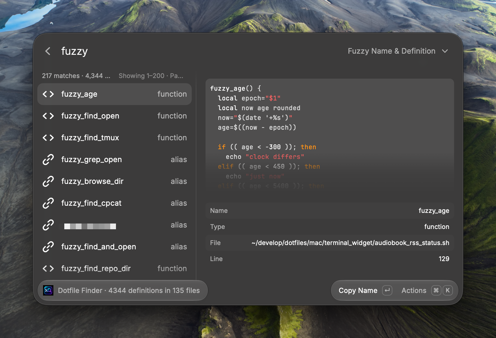

<p align="center">
  
</p>

# Dotfile Function Finder

Find shell aliases, functions, and scripts in Raycast. Search their names or contents, preview the source, copy what you need, or jump to your editor.

<p align="center">
  
</p>

## Install

You need Node.js/npm and Raycast. From the project directory:

```sh
# Validate, build, and install a normal local release.
./install_extension.sh

# Install dependencies and start development with live reloading.
./dev_install_extension.sh
```

Both scripts locate their own directory, so they also work when invoked from elsewhere. The normal installer uses `npm ci` if dependencies are missing, runs lint, builds into Raycast's local extensions directory, and exits. No development process needs to remain running. Lint may need network access to validate Raycast's schema and author. Failures return a nonzero exit code.

The development script runs `npm install` followed by `npm run dev`. Keep it running while editing and press **Ctrl+C** to stop. Stop any watcher started before moving the project, then restart it from the current checkout. Run the normal installer for a final validated build.

Open **Search Aliases, Functions and Scripts** in Raycast. Both scripts display the version from `package.json`, with emoji and colored messages: cyan for progress, green for success, yellow for stopping, and red for errors. Colors are disabled for redirected output, `TERM=dumb`, or a nonempty `NO_COLOR`.

Manual equivalents, from the project directory:

```sh
# Development
npm install
npm run dev

# Normal local installation
npm ci
npm run lint
npm run build
```

## Search and actions

- **Fuzzy Name & Definition** searches names and complete definitions or script contents, ignoring case and removing whitespace, dashes, and underscores. `git checkout`, `git-checkout`, `git_checkout`, and `gitcheckout` are equivalent. Characters can also match with gaps: `g c o` matches `git_checkout`. Name matches rank ahead of matches found only in contents. Literal names and substrings rank ahead of scattered matches. Contents include comments and strings, so broad queries can match many long definitions.
- **Exact Name** matches the entire name, ignoring case. Spaces and punctuation remain significant. For scripts, include the filename extension when present. Switch modes with the search dropdown (`⌘P`). An empty query lists everything.
- **Return:** copy the name, including a script's filename extension.
- **⌘⇧C:** copy the complete alias declaration, function definition, or script contents.
- **⌘E:** open the source using `VISUAL`, falling back to `EDITOR` when `VISUAL` is empty. Scripts open at line 1.
- **⌘] / ⌘[:** next/previous results page. Page navigation entries also appear at the bottom of the list.
- **⌘R:** refresh the index after edits. Files also reload whenever the command opens.

The action menu also provides **Show in Finder**, **Configure Search Paths**, **Show Index Summary**, and any scan warnings. The preview shows the source file and line. Duplicate names in different locations remain separate results.

### Result types

The text to the right of each result identifies its type:

| Label          | Source                                                                                |
| -------------- | ------------------------------------------------------------------------------------- |
| `alias`        | An ordinary shell alias                                                               |
| `glob alias`   | `alias -g`, called a **global alias** in Zsh; it expands outside command position too |
| `suffix alias` | Zsh's `alias -s`                                                                      |
| `function`     | A shell function definition                                                           |
| `script`       | A complete script discovered through Script Search Directories                        |

The section header shows total matches, total indexed entries, and the displayed range. Results appear in pages of 200. Search always runs over the complete index before paging; matches beyond the first 4,999 remain searchable and reachable. **Show Index Summary** reports the version, counts for each result type, file count, and warnings. There is no alias/function/script count limit; the scan safety limits below still apply.

## Configure search locations

Use **Configure Search Paths** in the action menu or open the extension's preferences. Both fields accept multiple locations separated by semicolons and expand `~` and `$HOME`.

### Dotfile Search Paths

Supply files or directories containing aliases and functions, for example:

```text
~/.config/zsh; ~/.aliases; ~/.functions
```

The defaults cover common shell startup files and home-directory alias/function files. Add your own dotfiles directory here. Existing saved preferences remain unchanged when you update the extension.

Directories are scanned recursively for `.sh`, `.zsh`, `.bash`, shell startup files, and files named `alias`, `aliases`, or `functions`. Explicit files can have any extension. Symlinked source files are indexed once. Conditional declarations are included even if their branch is inactive on the current machine. `source` statements and plugin loading are not evaluated.

### Script Search Directories

Supply directories containing scripts, for example:

```text
~/.local/bin; ~/bin
```

This field is optional and starts empty. Directories are scanned recursively for common script extensions (shell, Python, JavaScript/TypeScript, Ruby, Perl, Lua, PowerShell, AppleScript, Swift, and others) and text files beginning with a shebang (`#!`). Shebang detection includes extensionless scripts. Files do not need execute permission to be browsed. Unrelated documents and binary files are excluded.

The result name is the filename, including any extension, and the searchable/copyable definition is the entire file. A script is never executed by this extension. Symlink command names remain discoverable, while repeated references to the same file with the same name are deduplicated. The editor opens the resolved source file.

The scopes are independent: listing the same file in both can expose its shell definitions and the complete script. The file count counts unique physical files across both scopes.

### Scan limits

Dependency/build directories, unrelated hidden directories, binary files, and files larger than 2 MB are skipped. Missing locations are ignored; unreadable files and oversized files produce warnings. Each scope scans at most 20,000 entries and reports a warning if it reaches that limit. Symlink directory cycles are detected.

## Editor

The extension reads `VISUAL`, `EDITOR`, and `PATH` from your interactive login shell when you choose **Open in VISUAL or EDITOR**. This supports exports in `.zshrc` even when Raycast's GUI environment does not contain them. Editor commands can include flags and quoted executable paths. A configured `VISUAL` that fails reports an error; `EDITOR` is used when `VISUAL` is unset or empty.

Zed, VS Code/VSCodium, Cursor, Windsurf, Sublime, TextMate, Vim/Neovim, Nano, Emacs, and Helix receive a line-location argument. Other editors receive the source filename. Common terminal editors open in macOS Terminal, which may request Automation access on first use. The extension does not modify source files.

## Parsing scope

The dotfile index reads source text without executing it. It recognizes literal `alias` declarations (including global/suffix flags and multiple assignments), `name() { … }`, and `function name [()] { … }`. It handles multiline bodies, quoting, parameter/command substitutions, comments, and heredocs. Definitions inside a function body are not separately indexed.

This is a source browser, not a snapshot of the active shell. Later overrides remain visible. Dynamically generated definitions, `eval`, autoload-only function bodies, alternate function-body syntax, and computed names are not resolved. The lexer covers common Bash/Zsh syntax rather than implementing a complete shell grammar. Script indexing reads complete files and does not depend on this shell parser.

## Versions and changelog

`package.json` is the single source of the current semantic version. The UI's index summary and both scripts read it directly; `package-lock.json` mirrors it. User-facing changes belong in [CHANGELOG.md](CHANGELOG.md).

To release an update:

1. Describe changes under **Unreleased** in the changelog.
2. Run one of the following from the project directory:

   ```sh
   npm version patch --no-git-tag-version  # fixes
   npm version minor --no-git-tag-version  # new compatible features
   npm version major --no-git-tag-version  # breaking changes
   ```

   These commands update the package and lockfile without automatically creating a commit or tag.

3. Move the Unreleased notes into a heading matching the new version and release date; leave an empty Unreleased section above it.
4. Run the validation commands below, then commit the package, lockfile, and changelog together. Run the installer to update your local extension.

## Validate

```sh
npm test
npm run lint
npm run build
```

Tests cover multiline extraction, heredocs, alias types, separator-insensitive fuzzy matching, exact names, script discovery and body search, symlink handling, editor arguments, and indexing/searching/paging more than 6,000 entries.
